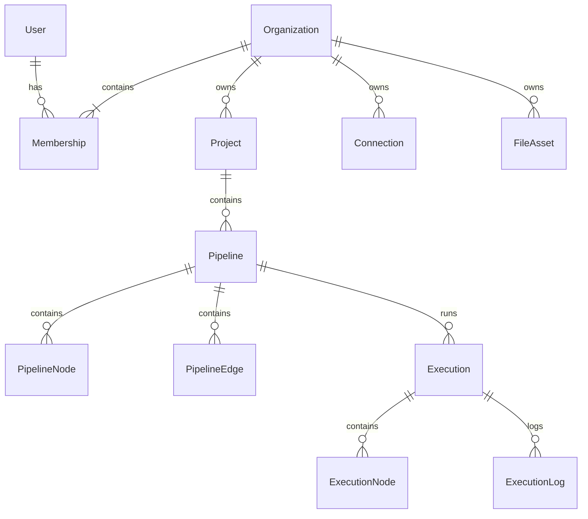

# Доменная модель

## Сущности

| Сущность | Смысл и ключевые правила |
|---|---|
| User | Учётная запись; может состоять в нескольких организациях |
| Organization | Граница доступа и владения данными |
| Membership | User + Organization + role; пара уникальна |
| Invitation | Одноразовое приглашение по email с ролью и сроком |
| Project | Контейнер pipeline внутри организации |
| Connection | Переиспользуемое подключение организации, metadata и encrypted credentials |
| FileAsset | Входной файл или результат; хранится отдельно от Connection |
| Pipeline | Редактируемое описание потока в проекте; revision |
| PipelineNode | Узел текущего графа: type, version, config, position |
| PipelineEdge | Направленная связь выходного и входного порта |
| Execution | Один запуск с immutable snapshot, trigger и статусом |
| ExecutionNode | Состояние узла snapshot, а не ссылка на живой редактируемый узел |
| ExecutionLog | Ограниченный структурированный журнал запуска |
| OutboxMessage | Техническая запись о необходимости доставить job |

## Связи

## Инварианты

У каждого проекта одна организация; pipeline не перемещается между организациями в MVP. Любой connection/asset в графе принадлежит той же организации, что pipeline. При передаче ID через API проверяется вся цепочка владения, а не только существование ID.

Connection доступен всем editor/owner организации, включая использование credentials в разрешённых запусках. Viewer видит только безопасные metadata. Если нужны ограничения по проектам или отдельным connections, это расширение политики, не уже существующая гарантия.

PipelineNode ID стабилен при редактировании данного узла. При удалении узла связанные edges удаляются в той же транзакции. ExecutionNode хранит snapshot node ID; удаление узла из draft не удаляет историю.

Connection с использованием в текущем графе или активном snapshot нельзя удалить; вернуть 409 с перечнем зависимостей. Для проекта и pipeline пользовательское «удаление» означает архивирование: запрет новых запусков, сохранение истории. Архивирование при активном запуске — 409. Постоянная очистка и retention — отдельная административная операция после MVP.

## Роли полного MVP

| Действие | owner | editor | viewer |
|---|---|---|---|
| Читать проекты, графы, историю, результаты | Да | Да | Да |
| Создавать/изменять проекты, графы и connections | Да | Да | Нет |
| Запускать и архивировать pipeline | Да | Да | Нет |
| Приглашать, менять роли, удалять участников | Да | Нет | Нет |

Организация должна иметь хотя бы одного owner. Проверка последнего owner выполняется транзакционно. Invitation принимается только авторизованным пользователем с подтверждённым совпадающим email; хранится хеш токена, срок по умолчанию 7 дней, повторное использование запрещено. Email-доставка не обязательна в MVP: owner может скопировать одноразовую ссылку.

## Статусы

Execution: `queued → running → succeeded | failed`; также `queued → failed` для невалидного snapshot, недоступного connection revision или превышения времени ожидания. Терминальные статусы не меняются.

ExecutionNode: `pending → running → succeeded | failed`; `pending → skipped` при прерывании потока. При потере worker текущий running node становится failed, остальные pending — skipped. Отмена, возобновление и частичный retry не входят в этот контракт.
