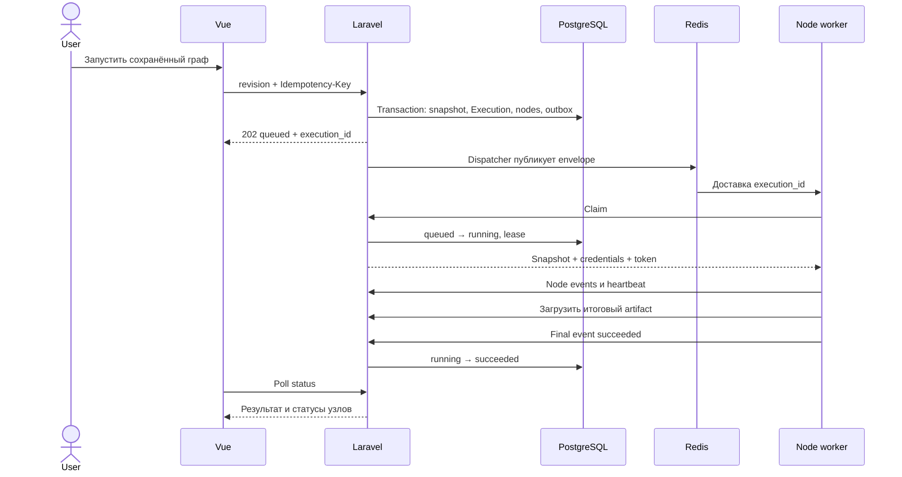

# Жизненный цикл запуска

## Успешный сценарий



## Демонстрационные данные

Вход CSV:

```csv
order_id,status,total
101,paid,12.50
102,pending,8.00
103,paid,20.00
```

Filter `status equals paid`; Map `order_id → id`, `total → amount`. Ожидаемый результат:

```csv
id,amount
101,12.50
103,20.00
```

Объём 3 → 2 → 2; значения остаются строками. Это контрактная фикстура для backend validation, worker и UI acceptance, не только иллюстрация.

## Ошибки и ожидаемое поведение

| Ситуация | Результат |
|---|---|
| Цикл или чужой connection | 422/404 до Execution, никакой job |
| Устаревшая revision | 409; предложить обновить граф |
| Повтор HTTP с тем же ключом | Тот же execution_id |
| Новый ключ, pipeline уже активен | 409 |
| Save во время исполнения | Новый draft revision, текущий snapshot прежний |
| Connection revision изменена до claim | failed CONFIG_CHANGED, secrets не выдаются |
| Неверный тип/отсутствующее поле | Узел failed с FIELD_MISSING/TYPE_MISMATCH; последующие skipped |
| Filter отсеял всё | succeeded, выход CSV с заголовками |
| Превышен размер/время | failed RESOURCE_LIMIT/TIMEOUT, частичный artifact не выдаётся |
| Повтор envelope | Только первый claim начинает работу |
| Redis временно потерян | queued сохранён в БД; reconciler публикует заново либо QUEUE_TIMEOUT |
| Worker умер | Watchdog завершает failed WORKER_LOST, без автоматического перезапуска |
| Ветка 1 записала данные, ветка 2 упала | Execution failed; успех ветки 1 сохраняется в истории и во внешней системе |
| API потерял ответ на final event | Worker повторяет тот же event_id, terminal состояние не откатывается |

## Отображение

`queued`: «Ожидает выполнения»; `running`: имя текущего узла; `succeeded`: результат; `failed`: проблемный узел, причина, возможные частичные изменения. Skipped — «Не выполнен из-за остановки потока», не самостоятельная ошибка.

При неизвестном объёме не показывать процент. Ошибки имеют стабильный code для разработчика и ясный текст для пользователя без stack trace/паролей. Polling останавливается на terminal, при потере сети UI показывает, что актуальное состояние неизвестно, не объявляет сам запуск failed.
