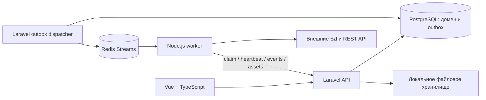

# Технический blueprint

Стек следует обсуждению. Детали взаимодействия — рабочее предложение v0.1.

## Ответственность

| Компонент | Отвечает за | Не отвечает за |
|---|---|---|
| Laravel | Auth, tenancy, CRUD, проверка графа, снимок, очередь намерений, запись статусов | Длительное исполнение pipeline в HTTP-запросе |
| PostgreSQL приложения | Долговечное состояние и транзакции | Хранение всех промежуточных наборов данных |
| Redis | Доставка уведомлений о заданиях | Единственный источник истины о запуске |
| Node worker | Коннекторы, преобразования, выполнение DAG, Dataset processing, schema propagation во время исполнения | Управление ролями и прямые записи в БД приложения |
| Vue | Конфигурация, визуальная проверка, schema-aware mapping, наблюдение | Авторитетное решение о доступе и валидности |

Внешний PostgreSQL connector логически отделён от PostgreSQL приложения. Использовать отдельную тестовую БД и credentials; не разрешать пользователю читать таблицы приложения через connector.

## Модули backend

Identity, Organizations, Projects, Connections, Pipelines, Executions, Files. Начать с обычных Laravel controllers, request validation, policies, services и моделей. Не вводить собственный framework, event sourcing и слой абстракций для каждой таблицы.

## Контракты

Версионировать `graph.schema_version`, `node.type_version`, Dataset/schema contract version и `message_version`. Хранить JSON Schema и положительные/отрицательные fixtures в будущем `contracts/`. PHP и TypeScript проверяют одинаковые примеры. Node Registry задаёт порты, конфигурацию, input/output contracts и правила schema propagation; frontend строит формы на их основе с отдельными удобными компонентами для mapping.

Laravel хранит описание графа в node/edge таблицах. Execution хранит JSONB snapshot — единственный граф для конкретного запуска. credentials разрешаются отдельно при claim; snapshot содержит только connection ID и revision. Изменение credentials до claim требует нового запуска, если revision больше не совпадает.

Dataset — логическая runtime-сущность между узлами, а не отдельный обязательный persisted object MVP. В v1 Dataset = schema + batch records + execution metadata. Laravel хранит definition/snapshot/metrics и проверяет tenant references; Node worker создаёт и преобразует Dataset в памяти в рамках лимитов. Позже эта граница позволит добавить chunking, pagination, streaming, backpressure и distributed execution без смены продуктовой модели.

## Минимальная надёжность

Создание Execution и outbox в одной транзакции. Публикация после commit. Дубликаты публикации допустимы и отсекаются атомарным claim. Потеря Redis не должна уничтожить запись о запросе на запуск. Состояния, heartbeat и восстановление описаны в [WORKER_PLAN](WORKER_PLAN.md).

## Эволюция

Сначала один worker и ограниченные Dataset batches в памяти. Затем schema inference, schema evolution, data quality, chunking/streaming и безопасные retries. Масштабирование начинается с нескольких процессов того же worker, когда есть измеренная нагрузка и тесты ownership. Выделение отдельных сервисов и distributed DAG — отдельное решение, не обязательная судьба проекта.
